

  

# Virtual Gears

**Wahoo left the KICKR V5 and older without virtual shifting. Virtual Gears
adds it.**

Virtual Gears puts an iPhone or iPad between your trainer and the app you ride
with.
Your riding app still controls the route and its hills; Virtual Gears adds the
gears. Choose **Shift with Virtual Gears** for ordinary FTMS apps, or
**Shift with Zwift or a compatible app** to let a riding app send its own gear ratios.


Leave the bike in a quiet, straight chain line and shift virtually instead.
Nothing moves on the bike, so shifting is silent and cannot drop the chain.

Because the bike stays in that one gear all ride, Virtual Gears asks you once
which gear it is. That ratio is what every virtual gear is scaled from, so the
app recommends the quietest gear that works and you confirm it in a tap.

**[Read the full documentation](https://sbroenne.github.io/VirtualGears/)**

## Why it exists

Wahoo brought built-in virtual shifting to the KICKR MOVE, KICKR V6 and KICKR
CORE, but says the KICKR V5 and older models will not receive it. Even on the
newer trainers, built-in shifting only works in Zwift and Rouvy.

Virtual Gears fills both gaps. It adds virtual shifting to the KICKRs Wahoo left
out, and it brings gears to ordinary FTMS riding apps without changing their
route data. If your KICKR already has built-in shifting, Zwift and Rouvy can use
it directly; Virtual Gears can still add gears in your other riding apps.

[Read Wahoo's compatibility statement](https://support.wahoofitness.com/hc/en-us/articles/16865097915666-Virtual-shifting-with-Wahoo-smart-trainers)

## What you need

| | Requirement |
|---|---|
| **Apple device** | iPhone or iPad running iOS/iPadOS 17 or later |
| **Trainer** | A compatible direct-drive Wahoo KICKR |
| **Riding app** | FTMS support for Shift with Virtual Gears; Zwift trainer-protocol support for Shift with Zwift or a compatible app |
| **Shifting** | Shift with Virtual Gears: on-screen buttons or original Zwift Click connected here. Shift with Zwift or a compatible app: controls in your riding app |
| **Fan** | Optional Wahoo KICKR HEADWIND |

Virtual Gears was built and physically tested with a KICKR V5. Other
direct-drive KICKR models are expected to work but have not yet been physically
tested. The KICKR SNAP, KICKR BIKE and trainers from other brands are not
supported.

The Bluetooth path has been physically tested on iPhone and iPad with a KICKR
V5 and original Zwift Click. The interface and ready/ride flows are also covered
on iPad mini and 13-inch iPad simulators, including portrait, landscape and
accessibility text.

On the riding-app side, FulGaz on macOS and Windows, plus RealVelo and MyWhoosh
on Windows, have been ridden end to end with **Shift with Virtual Gears**.
RealVelo on Windows has also been ridden with **Shift with Zwift or a compatible
app** on a KICKR V5: it recognises the trainer's virtual shifting and the gears
reach the KICKR. Zwift itself and other apps that use its protocol are expected
to work but have not been tested. Other FTMS riding apps are expected to work
but have not been tested.

[Detailed compatibility information](https://sbroenne.github.io/VirtualGears/requirements/#which-trainers-work)

## Your first ride

1. Wake the KICKR by turning the pedals.
2. Open Virtual Gears on the iPhone or iPad. It finds the KICKR, connects and
   makes it available to your riding app.
3. Tell the required first-run setup what is physically on the bike: chainrings,
   and either a cassette or a Zwift Cog/other single sprocket. Your first ride
   uses Standard 24 virtual gears automatically.
4. Move the chain to the quiet, reachable gear Virtual Gears recommends and
   confirm it.
5. In your riding app, connect to the trainer named **Virtual Gears**. Some apps
   may show the device's name instead.
6. Tap **Start Shifting**, then shift with the large **Easier** and **Harder**
   buttons.

Those steps use the default **Shift with Virtual Gears** mode. To use
**Shift with Zwift or a compatible app**, choose it directly on the start screen,
confirm the parked gear recommendation for that mode, and reconnect Virtual
Gears in your riding app. Pair the Click with the riding app instead of Virtual
Gears. **Start Shifting** is still required here before the app's ratios affect
the trainer. Virtual Gears shows the confirmed ratio; the riding app owns the
gear selection and display. Stop restores normal wheel size without ending the
riding app's ride. Stop shifting before changing modes or the physical gear.

Virtual Gears is a transparent trainer connection as soon as the KICKR is ready.
The physical fact it cannot guess is the gear the bike is parked in, because a
wrong guess would quietly make every gear wrong. **Start Shifting** engages the
gears; **Stop Shifting** removes them without disconnecting or stopping the ride
in your riding app. If it finds more than one trainer, it asks you to choose
yours by name.

The device screen stays awake while the trainer proxy is available. This keeps
Virtual Gears discoverable to riding apps on Windows and other computers before
they connect.

The same rule applies to optional equipment: one Click or Headwind is used
automatically; if several are found, Virtual Gears asks instead of guessing.

No trainer nearby? Tap **Try Demo** on the looking-for-trainer screen. Demo Mode
is clearly marked as simulated and lets you try the ride controls, gear ladder,
gear choices, Settings and example accessory controls. It does not scan,
connect, advertise or send Bluetooth commands, and it does not change saved
equipment. Demo Mode shows how the app works; it does not prove compatibility
with physical hardware.

## What it can do

- **Ready-made virtual gears**, in ladders of 24 with extra range for climbing.
- **App-independent shifting** for FTMS riding apps that have no virtual gears
  of their own.
- **Real groupsets**, from Shimano, SRAM and Campagnolo, or your own chainrings
  and cassette if your bike is not listed.
- **Gears that shift the way an electronic groupset shifts**, one cog at a time
  with the front change folded in, so there are no dead shifts and no invented
  gaps.
- **On-device shifting** with large controls in portrait and landscape, including
  iPad full screen, Split View and Stage Manager.
- **Accessible ride controls** with VoiceOver gear feedback, adjustable gear
  control and support for larger text.
- **Persistent equipment statuses** that keep the trainer, Click, fan and
  riding app visible independently, including while the riding app is waiting.
- **Two shifting modes**, with gears controlled here or by your riding app.
- **Automatic optional-equipment discovery** for an original Zwift Click in
  Shift with Virtual Gears and
  Wahoo KICKR HEADWIND.
- **Optional Zwift Click shifting** from the handlebar.
- **Headwind control** with Automatic, Off, 25%, 50%, 75% and 100% settings.
- **Mid-ride changes** to the trainer, gears, Click or Headwind.
- **Ride continuity** when you answer a call or briefly switch apps.
- **A Bluetooth-free Demo Mode** for exploring the app without equipment.

## Screenshots

  <a href="docs/app-store/ipad-13/riding.png">
    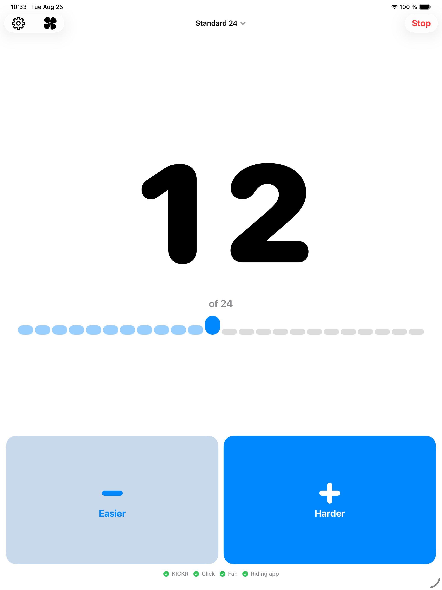
  </a>
  <a href="docs/app-store/ipad-13/setup.png">
    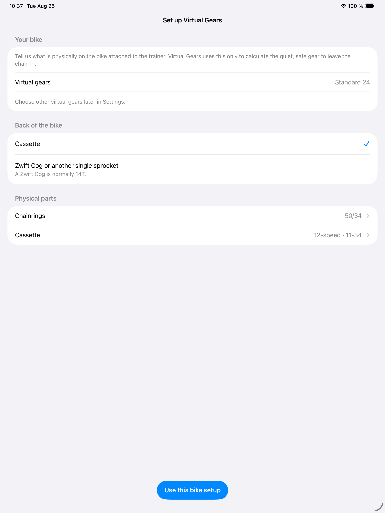
  </a>

<strong>Native iPad ride and setup layouts</strong>

<table>
  <tr>
    <td width="50%" align="center">
      <a href="docs/screenshots/riding-landscape.png">
        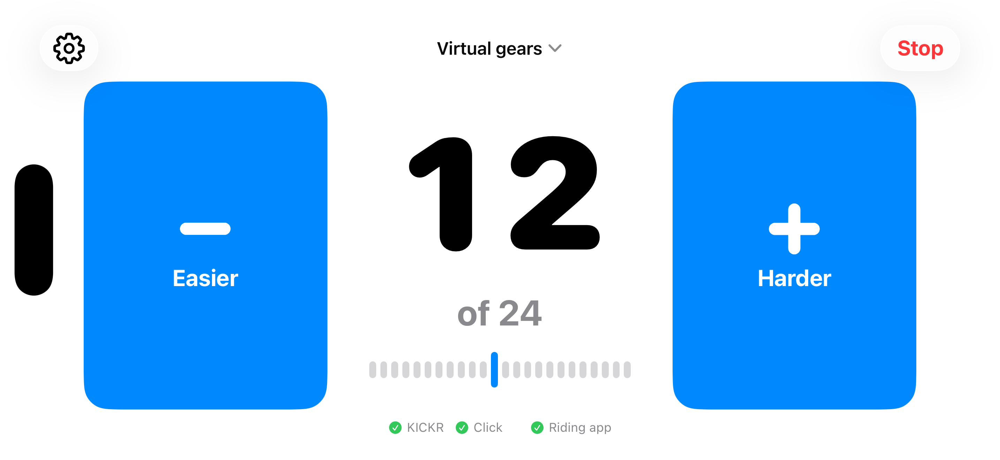
      </a>
       
      <strong>Ride and shift</strong>
    </td>
    <td width="50%" align="center">
      <a href="docs/screenshots/headwind-control-landscape.png">
        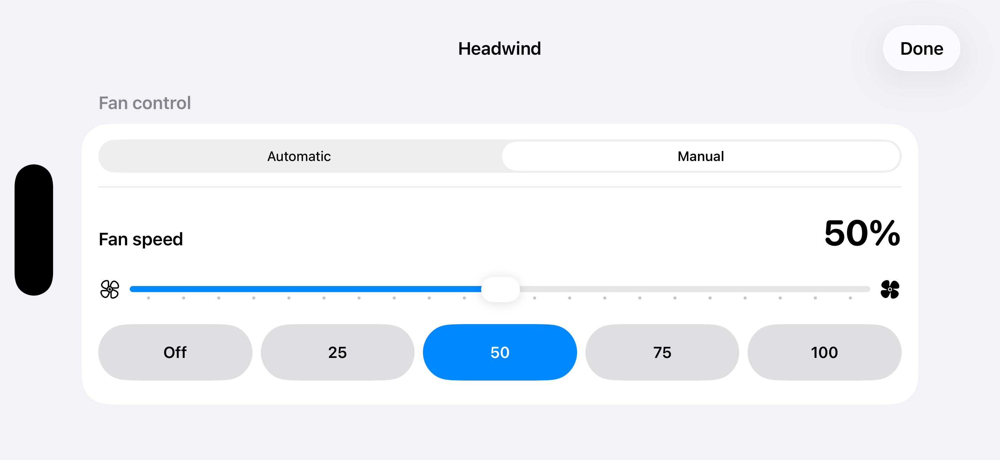
      </a>
       
      <strong>Control the Headwind</strong>
    </td>
  </tr>
</table>

  
<strong>More screenshots</strong>

   
  

    <a href="docs/screenshots/riding.png">
      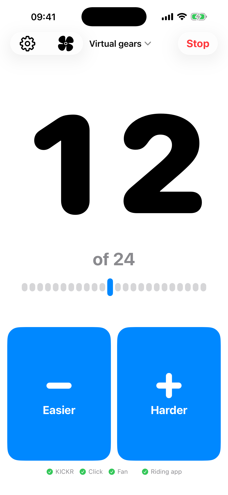
    </a>
    <a href="docs/screenshots/setup.png">
      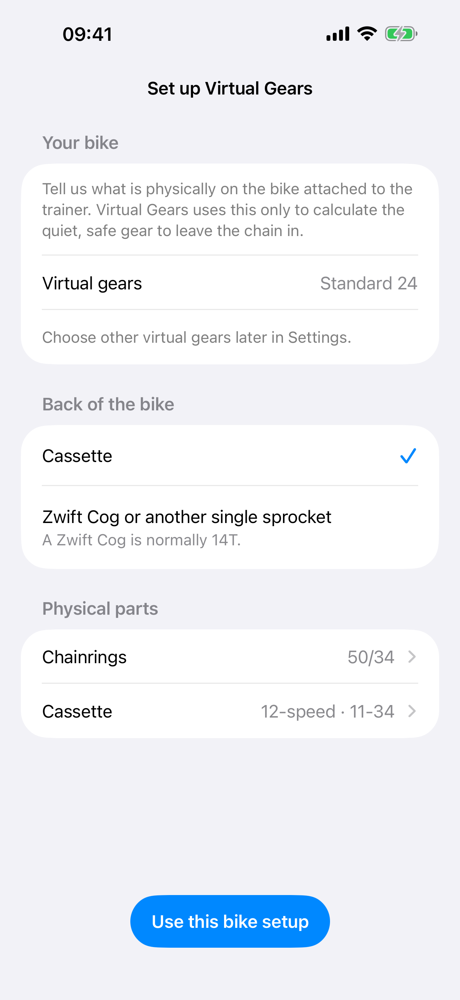
    </a>
    <a href="docs/screenshots/bike-setup.png">
      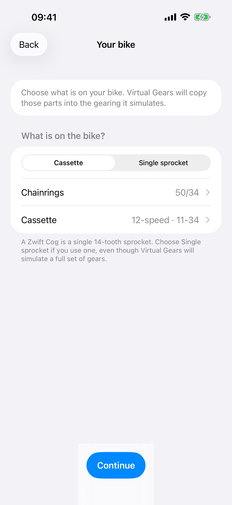
    </a>
  

  

    <a href="docs/screenshots/parked-gear.png">
      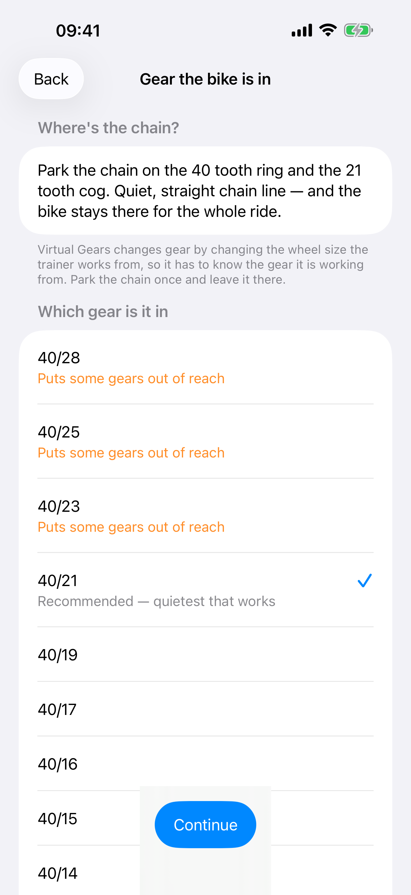
    </a>
    <a href="docs/screenshots/gears.png">
      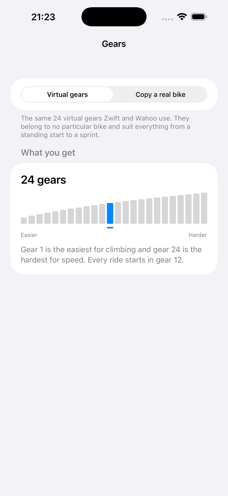
    </a>
    <a href="docs/screenshots/headwind-control.png">
      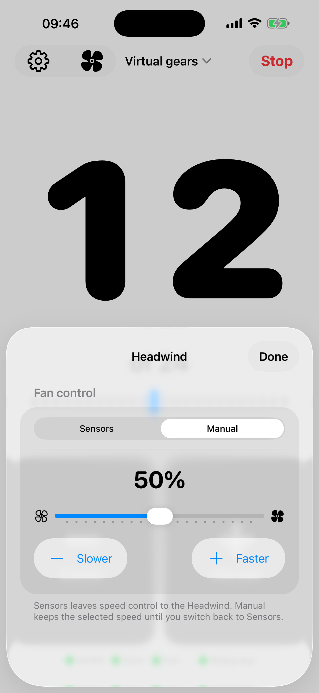
    </a>
  

## How it works

Virtual Gears acts as a Bluetooth FTMS trainer for the riding app and as a
controller for the real KICKR. It passes the riding app's commands and trainer
data through, then applies the selected gear by changing the wheel
circumference configured on the KICKR.

Every gear change waits for confirmation from the trainer. In
Shift with Zwift or a compatible app, an app-requested ratio is scaled from the confirmed
physical gear rather than mapped to our own gear ladder. Ratios beyond the safe
range are limited and the actual confirmed ratio is reported back.

[How the gears work](https://sbroenne.github.io/VirtualGears/how-it-works/) ·
[Safety details](https://sbroenne.github.io/VirtualGears/safety/) ·
[Accessibility](https://sbroenne.github.io/VirtualGears/accessibility/)

## Important limitations

- **ERG workouts are not supported in either mode.** ERG mode controls target
  power, while Virtual Gears controls how hard a gear feels.
- **Shift with Virtual Gears cannot report a gear to the riding app.** Ordinary
  FTMS has no gear-number message. In Shift with Zwift or a compatible app the riding app
  chooses the gears and Virtual Gears reports the applied ratio.
- **Virtual-shifting support is protocol-specific.** Shift with Zwift or a compatible app
  requires an app that recognises the added Zwift trainer service. It is not a
  promise that every app with a virtual-shifting feature will work.
- **Virtual Gears cannot read the trainer's current wheel circumference.** It
  uses the optional **Wheel circumference** saved in Settings, or the 2105 mm
  (700×25 road) default, unless the riding app supplies another size. Common
  wheel-size shortcuts and direct millimetre entry are available. If you use a
  custom value in the Wahoo app, enter the same value in Virtual Gears before
  shifting.
- **A riding app on Windows may not reconnect on its own after a Bluetooth
  drop.** If the wireless link between your Apple device and the computer times
  out mid-ride, some Windows riding apps do not scan for the device again by
  themselves; you may need to restart the riding app to see Virtual Gears once
  more. This is the riding app's own reconnect behaviour, not something Virtual
  Gears controls.

## Support

Questions go in [Q&A discussions][qa]; bugs go in [Issues][newissue]. The
[support page](https://sbroenne.github.io/VirtualGears/support/) lists the
common problems and their answers first.

  [qa]: https://github.com/sbroenne/VirtualGears/discussions/categories/q-a
  [newissue]: https://github.com/sbroenne/VirtualGears/issues/new/choose

## Independent project

Virtual Gears is not affiliated with Wahoo Fitness or Zwift. Wahoo, KICKR,
HEADWIND, Zwift and Zwift Click are trademarks of their respective owners.

## Acknowledgements

The FulGaz-on-Windows compatibility investigation was informed by the outward
Bluetooth behavior of [QZ (qdomyos-zwift)](https://github.com/cagnulein/qdomyos-zwift),
an independent GPL-3.0 project. Virtual Gears implements the standard Bluetooth
services independently; no QZ source code is copied or bundled.
Public Zwift trainer message schemas and observed protocol exchanges in QZ
also informed the independently written Zwift-compatible codec; no generated
protocol code, trainer identity or serial number is copied.

## Licence

Copyright &copy; 2026 Stefan Broenner. All rights reserved.

The source is public so it can be read and checked, but it is not open source.
Redistribution and publishing derived applications are not permitted. See
[LICENSE](LICENSE) for the exact terms.

[Development and hardware-testing documentation](DEVELOPMENT.md)
