# Shifting modes and gearing



Virtual Gears was built and physically tested with a KICKR V5. Other
direct-drive KICKR models are expected to work but have not yet been physically
tested. It uses a Wahoo command that changes the trainer's idea of your wheel
size: a smaller wheel covers less ground per pedal stroke, which feels like an
easier gear. The riding app's own terrain command is left untouched, so the two
never fight.

## Choose who controls the gears

Choose the mode directly on the start screen. The default is **Shift with
Virtual Gears**: Virtual Gears chooses and displays the gears, and the riding app
sees an ordinary FTMS trainer. Connect an original Click to Virtual Gears, or
use the on-screen buttons. The diagram above illustrates this mode.

In **Shift with Zwift or a compatible app**, the riding app chooses the gears and sends
Virtual Gears a gear ratio over the Zwift trainer protocol. Connect your Click
to that app instead. Virtual Gears does not connect to the Click in this mode
and does not apply its own gear ladder. It displays the ratio confirmed by the
KICKR, not an invented gear number.

The KICKR keeps its configured bike/rider weight: weight fields in the Zwift
commands are not currently forwarded.

```text
Click -> Riding app -> Virtual Gears -> KICKR
                   <-               <-
                   Status, power and cadence
```

Stop shifting before changing modes. The Bluetooth services are republished
when the mode changes, so reconnect the trainer in your riding app.
The Zwift option refers to the protocol, not an affiliation or certification.
RealVelo is the first hardware-validation target for this change. Its earlier
FTMS ride does not prove the new protocol path; physical validation remains a
required gate for this PR.

Opening Virtual Gears connects this transparent trainer proxy. **Start Shifting**
adds the gears; **Stop Shifting** removes the virtual gear and restores the
normal wheel circumference. Neither button starts or stops the ride in the
riding app, and stopping shifting leaves that app connected.

The device screen stays awake for as long as this trainer proxy is available.
iOS and iPadOS change Bluetooth advertising after the device locks, which can make a
waiting trainer disappear from riding apps on Windows and other computers.

## The gear your bike is parked in

Your bike does not shift at all. It sits in one gear for the whole ride, and that
gear is half of what your legs feel:

    feel  =  parked gear ratio  x  the wheel size we set

Virtual Gears only controls the second half, so it has to be told the first.
Skipping the question does not make it go away — it just means assuming an
answer. And "a quiet, straight chain line" is true of a lot of very different
gears:

| Parked in | Ratio | If the app had assumed 2.4 |
|---|---|---|
| 31-tooth ring, Zwift Cog | 2.21 | about 8% easier than shown |
| Small ring, middle cog | 2.43 | almost exactly right |
| Big ring, middle cog | 3.33 | about 39% harder than shown |
| Big ring, smallest cog | 4.55 | 90% harder — the easy half of the ladder would not exist |

The step *sizes* stay right either way, because the scaling is relative. What
moves is the whole ladder, which is why this would never look like a bug: the
shifting feels fine, the gears are simply not the ones on screen.

So Virtual Gears asks once, and makes the good answer the default. It works out
the quietest gear that still keeps every gear reachable — the trainer's wheel-size
command tops out at 6553.5 mm, which puts a hard floor under how easy a parked
gear can be — and recommends that. Confirm it, or say what you actually used.

Indoors the trainer is the loudest thing in the room and its flywheel speed comes
from the parked ratio, so a middle cog on the small ring runs around half the
flywheel speed of the big ring on the smallest cog. Because the app compensates
for whatever you confirm, the parked gear can be chosen purely for quiet.

## Where the gears sit

### App-controlled ratios

In Shift with Zwift or a compatible app, the effective circumference is:

    normal wheel size x app-requested ratio / physical parked ratio

The normal wheel size is 2105 mm unless changed in Settings or supplied by the
riding app. A ratio received before Start is remembered but not applied. Queries
report the normal physical ratio until Start, never an unconfirmed requested
ratio. After Start, replies report the actual ratio derived from the
KICKR-confirmed, tenth-millimetre wheel size. Out-of-range ratios are limited
to the existing supported scaling window, with the limit recorded in the log.

The usual Zwift ratio range is approximately 0.75-5.49. Parked-gear advice
uses that range in this mode, rather than whichever independent gear ladder is
saved. Stop and interruption recovery restore the normal wheel size.

Terrain parameters are translated to FTMS for the KICKR. ERG power targets
are refused in this mode too; use a riding app's own ERG connection without
Virtual Gears for structured power workouts.

### Independent gear ladders

Every gear is scaled away from the optional **Wheel circumference** in Settings,
2105 mm (700×25 road) by default, and from the gear the bike is parked in. The
default ladder reaches about four times easier and 2.3 times harder while
keeping gear 12 as the starting point. A drivetrain too wide to fit, or a parked
gear that would put part of the ladder out of the trainer's reach, is refused at
setup rather than mid-ride.

The starting gear is a declared number rather than one derived from the safety
limits, so editing an unrelated limit cannot quietly move which gear you begin
in.

## When the riding app has its own idea

Wheel size is part of the standard interface available to every riding app.
Whenever one sets it, Virtual Gears honours it: that size becomes the new
reference and every gear is rebuilt around it, so the gear you are in keeps
feeling the way it did. Virtual Gears supports wheel sizes from 1800 mm to
2400 mm, which covers every real bicycle wheel; anything outside that is
declined and the ride carries on at the size it already had.

If the riding app sends no size, the saved normal circumference is used. If it
does send one, its value takes precedence and is restored when shifting stops.

## Shifting waits for the trainer

Asking for a gear and getting it are not the same thing. Virtual Gears asks for
the next gear only once the trainer has confirmed the last one, so holding a
shift button sweeps through gears at whatever pace the trainer can really manage
and stops the moment you let go. It cannot run ahead and hand you gears you did
not ask for.

Measured on a Wahoo KICKR V5, a gear change is confirmed in 59 to 238 ms,
averaging 138 ms.

The timing measurements above are from Shift with Virtual Gears. The
Zwift-compatible path has automated codec and coordinator checks; its
RealVelo/KICKR physical test is required separately.
